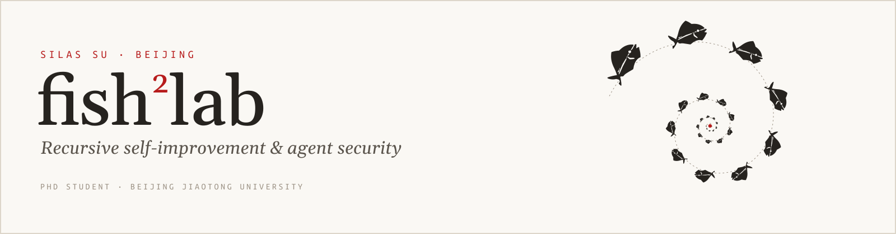

<a href="https://github.com/fish2lab/fish2lab/tree/main/art">
  <picture>
    <source media="(prefers-color-scheme: dark)" srcset="art/header-dark.svg" />
    <source media="(prefers-color-scheme: light)" srcset="art/header.svg" />
    
  </picture>
</a>

PhD student at Beijing Jiaotong University. My research is turning to **recursive self-improvement**: models are now strong enough to improve themselves at the harness layer, and I want to know what that loop does next and how it stays trustworthy. I came to it from LLM agent security and keep working on both. I also shoot medium-format film, study mathematics, and write about the systems that shape learning and everyday life.

北京交通大学博士生，研究重心正转向**递归自我改进（RSI）**：模型已经强到能在 harness 层改进自己，我想知道这个循环的下一步是什么、怎样保持可信。我从 LLM agent 安全走过来，两边都还在做。也拍中画幅胶片、学数学，记录技术、学习与日常生活里的系统性问题。

[fish2lab.com](https://fish2lab.com) · [x.com/fish2lab](https://x.com/fish2lab) · [fish2lab@gmail.com](mailto:fish2lab@gmail.com)

## Now · 2026‑10

<table>
  <tr>
    <td width="110" valign="top"><b>RESEARCHING</b></td>
    <td>Recursive self-improvement. Models are now strong enough that the intuitive old tricks of deep learning (regularization, off-policy experience, held-out evals) can be applied at the harness layer to make them better. If RSI is retracing the path of deep learning and LLMs, what is the next step, and the one after that? For example, how does an editable verifier stay trustworthy? I want problems whose value doesn’t shrink as models get stronger.</td>
  </tr>
  <tr>
    <td valign="top"><b>LEARNING</b></td>
    <td>Learning with agents. Honestly, with agents this capable I’ve mostly used them for low-ROI, high-joy things like Three.js and art-ish projects. Meanwhile I skipped something a 4o-level model could already do well: guiding my own learning. Fixing that.</td>
  </tr>
  <tr>
    <td valign="top"><b>WONDERING</b></td>
    <td>Personal agents vs. the human as a chaotic system. Today’s personal agents do things for you. They don’t yet guide meta-actions, teach you to do the right thing, make it easier, and grow your metacognition and motivation along the way. Some things, especially the body and health, can only be learned by doing. Why has no agent tackled “life” as a high-level problem yet?</td>
  </tr>
  <tr>
    <td valign="top"><b>STUDYING</b></td>
    <td>Learning what stays useful after AGI. I’m working on CS and security fundamentals, mainly so I can tell when a plausible-looking answer is wrong.</td>
  </tr>
  <tr>
    <td valign="top"><b>ENJOYING</b></td>
    <td>Art in all its forms.</td>
  </tr>
</table>

## Building

<table>
  <tr>
    <td width="50%" valign="top">
      <b><a href="https://github.com/fish2lab/DSCodex">DSCodex</a></b> 
      DeepSeek V4.1 Flash inside the unmodified ChatGPT desktop app, Codex CLI and IDE. Local loopback router, native Responses API, full tool loops, GPT OAuth kept side by side. No fork, no patch. 
      在原版 Codex / ChatGPT 桌面端同时使用 DeepSeek 与 GPT。<code>JavaScript&nbsp;·&nbsp;MIT</code>
    </td>
    <td width="50%" valign="top">
      <b><a href="https://github.com/fish2lab/touhou-code-video-template">touhou-code-video-template</a></b> 
      A fully voiced Touhou fan explainer in nothing but JavaScript and Canvas 2D: 14 procedural paper‑cut chibi characters, Yukkuri voice, music‑box BGM, and a deterministic renderer where every frame is a function of time. Zero image assets; ships with AGENTS.md and llms.txt. 
      纯代码做一集东方科普视频，帕秋莉讲座系列的引擎。<code>JavaScript&nbsp;·&nbsp;Canvas&nbsp;·&nbsp;MIT</code>
    </td>
  </tr>
  <tr>
    <td valign="top">
      <b><a href="https://github.com/fish2lab/os-lab-mcp">os-lab-mcp</a></b> 
      Template repo for an OS interfaces course lab: an agent driver on pi plus an MCP bridge, packet recorder and process‑tree observer. Students write the tool handlers, a realpath check and one sandbox rule, then catch a path‑traversal attempt in the logs. 
      《操作系统接口技术》验证实验：Agent 经 MCP 访问 OS 资源。<code>TypeScript</code>
    </td>
    <td valign="top">
      <b><a href="https://github.com/fish2lab/sukima-ml">sukima-ml</a></b> 
      Website for 隙间月影 Sukima Moonlight, a doujin circle pairing classic paintings with Touhou Project. Dual‑frame gallery, a Galgame‑style guide, museum‑grade CSS matting. 
      名画与东方 Project 的邂逅。<code>TypeScript&nbsp;·&nbsp;Docusaurus</code>
    </td>
  </tr>
  <tr>
    <td valign="top">
      <b><a href="https://github.com/l0ng-ai/tty7">tty7</a></b> upstream 
      A pure‑Rust terminal workbench on Zed's gpui with persistent sessions and coding‑agent awareness. My <a href="https://github.com/l0ng-ai/tty7/pull/880">#880</a> answers the macOS Dock's reopen event, so a tty7 whose last window was closed comes back instead of staying retired. 
      给 tty7 补上 macOS Dock 重新打开窗口的行为。<code>Rust&nbsp;·&nbsp;merged&nbsp;2026‑09‑14</code>
    </td>
    <td valign="top">
      <b><a href="https://github.com/typex-ink/Typex">Typex</a></b> upstream 
      An open‑source desktop voice input tool. My <a href="https://github.com/typex-ink/Typex/pull/2">#2</a> adds Xiaomi MiMo ASR and explicit hotkey trigger modes. 
      给 Typex 接入小米 MiMo 语音识别与显式快捷键触发。<code>Rust&nbsp;·&nbsp;merged&nbsp;2026‑07‑30</code>
    </td>
  </tr>
</table>

## Where things live · 内容入口

<table>
  <tr>
    <td width="33%" valign="top">
      <b>Portfolio · 作品集</b> 
      Medium‑format documentary, landscape, street and conceptual series. 
      <a href="https://portfolio.fish2lab.com">portfolio.fish2lab.com →</a>
    </td>
    <td width="33%" valign="top">
      <b>Research · 研究</b> 
      Field notes, probes and work in progress on LLM security and agent systems. 
      <a href="https://research.fish2lab.com">research.fish2lab.com →</a>
    </td>
    <td width="33%" valign="top">
      <b>Blog · 文章</b> 
      Essays on cognitive science, learning, health and everyday systems. 
      <a href="https://blog.fish2lab.com">blog.fish2lab.com →</a>
    </td>
  </tr>
</table>

The header is a school of fish on a logarithmic spiral, each one the last scaled by 0.88, drawn once by <a href="https://github.com/fish2lab/fish2lab/blob/main/art/render.mjs"><code>art/render.mjs</code></a>. <a href="https://github.com/fish2lab/fish2lab/tree/main/art">How it is drawn →</a>
